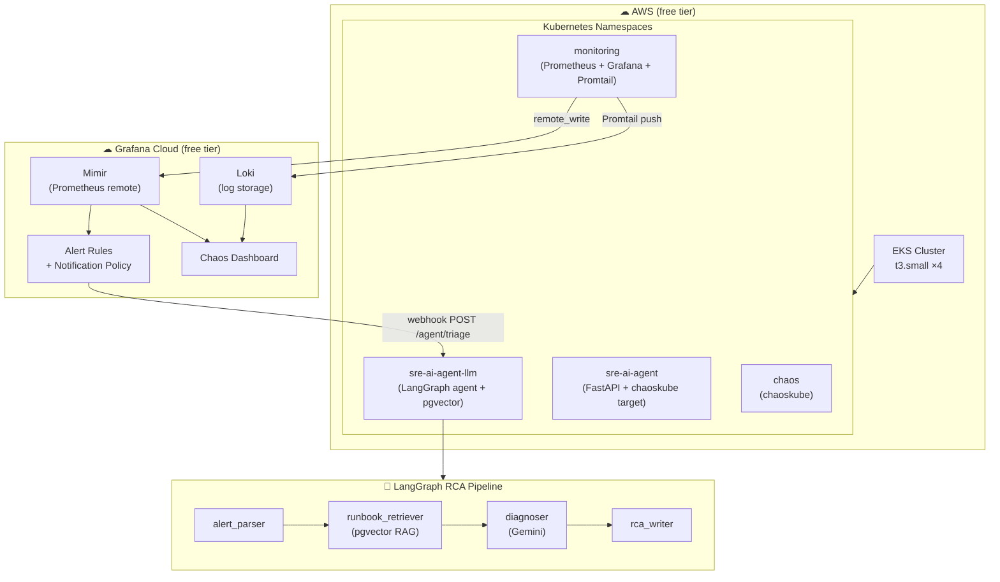
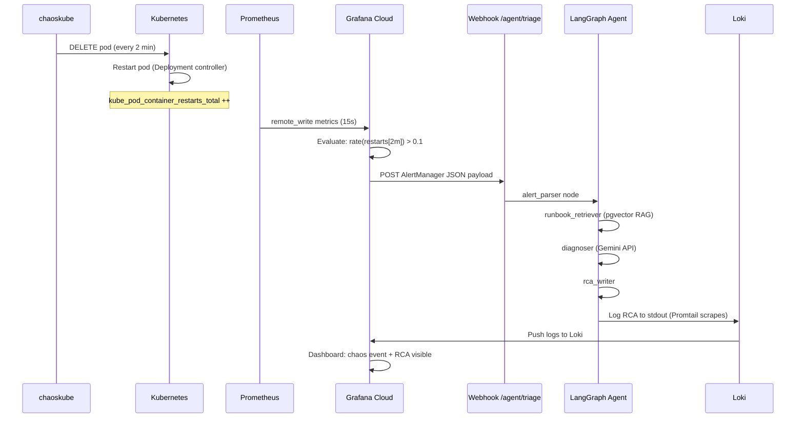
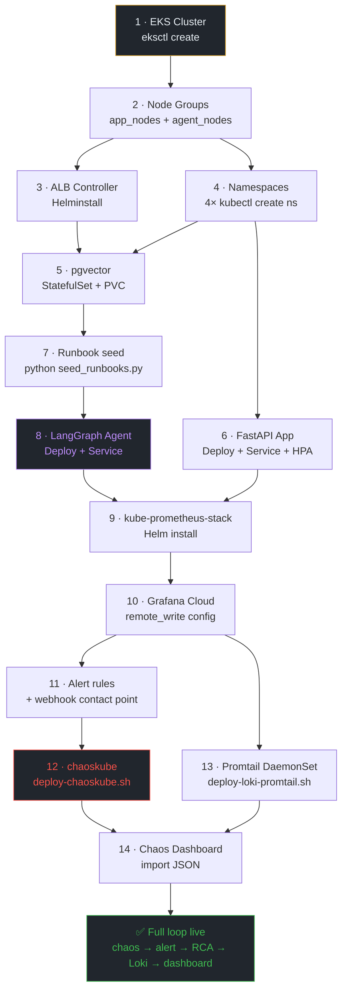
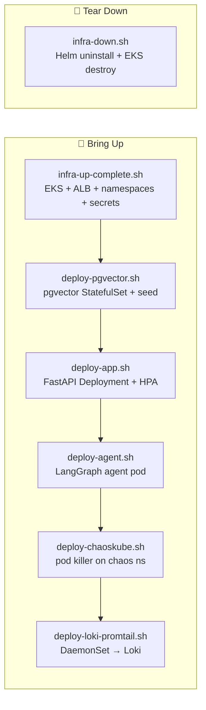

SRE-AI-Agent-Observability

# Complete Deployment Flow

Step-by-step build order — from EKS cluster to live chaos-to-RCA loop

4 Node Groups · t3.small EKS + Grafana Cloud LangGraph RCA Agent Phase 22 → 24

System overview

Deployment phases

Phase 22-A Infrastructure Bootstrap `infra-up-complete.sh` ▶

**1. EKS Cluster**eksctl creates cluster + VPC + subnets

**2. Node Groups**app_nodes (×3 t3.small) + agent_nodes (×1, tainted)

**3. IAM Roles**OIDC provider + service account IRSA bindings

**4. aws-load-balancer-controller**Helm install — provisions ALBs for services

**5. Namespaces**sre-ai-agent, sre-ai-agent-llm, monitoring, chaos

**6. Secrets**ECR pull secret, GEMINI_API_KEY, Grafana token

✓ kubectl get nodes → 4 Ready INSTALL_DATADOG=false INSTALL_LITMUSCHAOS=false

Phase 22-B pgvector + Runbook Seeding `deploy-pgvector.sh` ▶

**1. pgvector StatefulSet**PostgreSQL + pgvector extension in sre-ai-agent-llm

**2. PVC**10Gi EBS volume for vector index + runbook data

**3. Seed runbooks**Embed SRE runbook chunks → store in pgvector

**4. Verify**SELECT COUNT(\*) from runbook_chunks → N rows

✓ pgvector ready namespace: sre-ai-agent-llm port: 5432

Phase 22-C FastAPI App Deploy `deploy-app.sh` ▶

**1. Build image**docker build → push to ECR

**2. Deployment**3 replicas of FastAPI app in sre-ai-agent

**3. Service (LoadBalancer)**AWS ELB → /health, /metrics endpoints

**4. HorizontalPodAutoscaler**min=2, max=5 replicas on CPU 70%

✓ GET /health → 200 namespace: sre-ai-agent replicas: 3

Phase 22-D LangGraph Agent Deploy `deploy-agent.sh` ▶

**1. Agent image**Build LangGraph 4-node pipeline → push ECR

**2. Deployment**1 replica on agent_nodes (toleration: workload=ai-agent)

**3. Service (LoadBalancer)**Exposes /agent/triage for Grafana webhook

**4. GEMINI_API_KEY secret**Mounted as env var for diagnoser node

✓ POST /agent/triage → RCA returned namespace: sre-ai-agent-llm node: agent_nodes

Phase 22-E Prometheus + Grafana (local) `infra-up-complete.sh` ▶

**1. kube-prometheus-stack**Helm install — Prometheus + Grafana + AlertManager

**2. ServiceMonitors**Scrape sre-ai-agent /metrics every 15s

**3. PrometheusRules**High error rate, pod restarts, p99 latency alerts

**4. local Grafana dashboard**Import sre-ai-agent-dashboard.json

✓ Prometheus scraping namespace: monitoring port-forward: 3000

Phase 23 Grafana Cloud + Alerting Webhook `configure-grafana-cloud.sh` ▶

**1. remote_write config**Prometheus → Grafana Cloud Mimir (scarletcanary2090)

**2. Alert rules (Cloud)**Pod Restart Rate High, High Error Rate, p99 Latency

**3. Contact point**Webhook → http://\<AGENT_LB>/agent/triage

**4. Notification policy**Routes sre-ai-agent alerts to webhook contact point

**5. GRAFANA_CLOUD_API_KEY**Added to .env — used by Prometheus + Promtail

✓ Metrics visible in Grafana Cloud stack: scarletcanary2090 region: ap-south-1

Phase 24-A chaoskube (pod killer) `deploy-chaoskube.sh` ▶

**1. chaos namespace**Isolated from app — chaoskube runs here

**2. RBAC**ClusterRole: list+delete pods in sre-ai-agent only

**3. Helm install chaoskube v0.29.0**interval=2m, minimumAge=30s, \~50MB RAM

**4. Verify kill logs**kubectl logs -n chaos deployment/chaoskube

✓ Pod killed every 2 min target: sre-ai-agent DRY_RUN=false

Phase 24-B Promtail → Grafana Cloud Loki `deploy-loki-promtail.sh` ▶

**1. .env credentials**LOKI_USER_ID=1800xxx + GRAFANA_CLOUD_API_KEY

**2. promtail-loki-secret**kubectl create secret in monitoring namespace

**3. Helm install Promtail DaemonSet**values.yaml + --set credentials; 1 pod per node

**4. Scrapes 4 namespaces**sre-ai-agent, sre-ai-agent-llm, chaos, monitoring

**5. Verify in Grafana Cloud**Explore → Loki → {namespace="sre-ai-agent"}

✓ Logs in Grafana Cloud Loki url: logs-prod-028.grafana.net tolerations: Exists

Phase 24-C Grafana Cloud Chaos Dashboard `grafana-chaos-dashboard.json` ▶

**1. Import JSON**Grafana Cloud → Dashboards → Import

**2. Bind datasources**DS_PROMETHEUS → grafanacloud-...-prom · DS_LOKI → ...-logs

**3. 5 dashboard rows**Chaos Status · Impact · LangGraph RCA · Events · AI Quality

**4. Update webhook URL**Alerting → Contact point → set real AGENT_LB hostname

✓ Live chaos + RCA visible refresh: 30s 8 panels

Live chaos-to-RCA loop

Kubernetes namespace map

sre-ai-agent

- FastAPI app (×3)
- Service (LoadBalancer)
- ⚡ chaoskube TARGET
- HPA (2–5 replicas)

sre-ai-agent-llm

- LangGraph agent (×1)
- Service (LoadBalancer)
- pgvector StatefulSet
- PVC (10Gi EBS)

monitoring

- Prometheus
- Grafana (local)
- AlertManager
- Promtail DaemonSet (×4)

chaos

- chaoskube
- ClusterRole (RBAC)
- ServiceAccount

Build order dependency graph

.env file — all required keys

| Key | Example value | Used by |
| --- | --- | --- |
| AWS_REGION | ap-south-1 | eksctl, ECR, ALB |
| CLUSTER_NAME | sre-ai-agent-cluster | eksctl, kubectl context |
| ECR_REGISTRY | 123456.dkr.ecr.ap-south-1.amazonaws.com | docker build, Helm values |
| GEMINI_API_KEY | AIza… | LangGraph diagnoser node |
| GRAFANA_CLOUD_API_KEY | glc\_… | Prometheus remote_write, Promtail |
| LOKI_USER_ID | 1800xxx | deploy-loki-promtail.sh Basic Auth |
| GRAFANA_CLOUD_PROMETHEUS_URL | https://prometheus-prod-…/api/prom/push | Prometheus remote_write |
| INSTALL_DATADOG | false | infra-up-complete.sh flag |
| INSTALL_LITMUSCHAOS | false | infra-up-complete.sh flag |

Scripts at a glance

